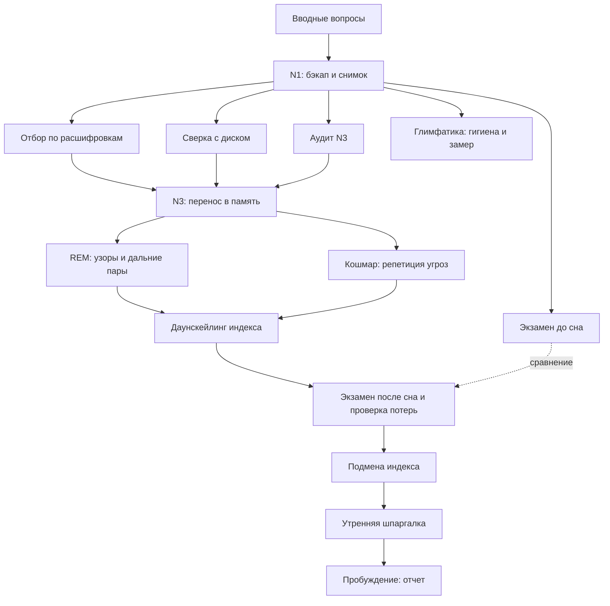

# memory-sleep

Скилл для Claude Code и Codex, который устраивает агенту сон: проход консолидации файловой памяти по фазам, названным по фазам сна живого организма. За один прогон агент сверяет память с диском, достает из расшифровок недели то, что ты говорил, а в память не попало, переносит уроки, сжимает индекс без потери фактов и приносит отчет с замерами до и после.

## Ради чего

Память кодового агента между сессиями — это файлы. Индекс `MEMORY.md` читается в начале каждой сессии, остальные файлы открываются по его ссылкам. За недели работы с памятью происходит три вещи.

- **Индекс разрастается.** Каждая сессия дописывает в строку еще один хеш, дату и статус. В Claude Code за пределом в 25 КБ или 200 строк хвост индекса в контекст уже не попадает.
- **Строки расходятся с диском.** В индексе написано «ждет ответа», а ответ пришел две недели назад; написано «не запушено», а ветка давно слита. Агент начинает сессию с неверной картины.
- **Сказанное остается в истории сессий.** Ты дважды поправил агента в разных сессиях, но правилом это не стало, и в третьей сессии он ошибется так же.

Сон чинит все три за один ограниченный по времени прогон и показывает числами, что изменилось.

## Как это работает



Агент ведет сон как оркестратор. Детерминированные шаги делает скрипт `scripts/sleep.py`, чтение и сверку — волны субагентов, которые работают только на чтение и пишут каждый в свой файл. Память правит сам оркестратор, по их отчетам и после бэкапа.

| Фаза | Что происходит с памятью |
| --- | --- |
| N1, засыпание | Архив памяти, копия индекса, замеры до сна, журнал фаз, защита от засыпания машины |
| N2, отбор | Реплики владельца за неделю разбираются на ADD, UPDATE и NOOP; строки индекса получают вердикт: свежо, устарело, неверно, не проверить |
| N3, перенос | Устаревшие строки заменяются, новые правила становятся файлами памяти, повторяющиеся сбои становятся уроками |
| Глимфатика | Файлы без frontmatter, битая кодировка, файлы вне индекса, что занимает место. Только замер |
| REM | Сбои, которые повторяются в разных проектах; идеи на стыке далеких проектов, каждая с проверкой опор по диску |
| Кошмар | Что сломается или пропадет в ближайшие недели: работа без копии, тихо умершие процессы, просроченные обещания, секреты |
| Даунскейлинг | Индекс сжимается пачками; факт уходит из строки, только если он записан в файле по ссылке |
| Пробуждение | Экзамен после сна, проверка потерь, подмена индекса, шпаргалка к утру, отчет |

**Экзамен.** Отдельный агент составляет вопросы, какие ты задаешь в начале сессии, и ключ к ним. Другой агент отвечает на них до сна и после, по одному индексу и не больше двух файлов на вопрос. Сжатый индекс ставится на место, только если ответы не стали хуже.

**Проверка потерь.** `sleep.py check` сравнивает кандидата с живым индексом: целая кодировка, те же разделы, те же ссылки, размер в пределе. Он же находит идентификаторы (пути, адреса, хеши, числа), которые исчезли из строки и которых нет в файле по ссылке. Пока список не пуст, `sleep.py install` индекс не подменит.

## Claude Code и Codex

Скилл один, шаги в нем названы по смыслу, а раздел «Среда» в `SKILL.md` говорит, чем их выполнять в каждой среде.

| | Claude Code | Codex |
| --- | --- | --- |
| Откуда берутся твои реплики | расшифровки сессий в `~/.claude/projects` | история запросов `~/.codex/history.jsonl` и сессии в `~/.codex/sessions` |
| Где лежит память | `~/.claude/projects/<проект>/memory` | та же папка или `~/.agents/memory` |
| Волны агентов | субагенты | субагенты, если включены; иначе задания выполняются по очереди |
| Вводные вопросы | вопросы с вариантами | список в чате |
| Метаданные скилла | frontmatter `SKILL.md` | тот же frontmatter и `agents/openai.yaml` |

Если ты работаешь в обеих средах, сон собирает реплики из обеих и пишет правила в одну память. Состояние прогонов общее, `~/.agents/memory-sleep`, поэтому сон, начатый одним агентом, виден другому.

У Codex своей файловой памяти с индексом может не быть. Тогда скилл предложит завести ее в `~/.agents/memory` или ограничится отбором по репликам и принесет предложения в отчете.

Без субагентов скилл работает, но экзамен до и после сна не проводится: его заменяют механическая проверка и ручная перепроверка сжатых строк.

## Вводные вопросы

При первом запуске скилл измеряет память и спрашивает:

1. какую память усыпляем, если их несколько;
2. сколько длится сон: 15, 30 или 60 минут;
3. что разрешено менять: память с бэкапом или только отчет с предложениями;
4. откуда брать правду, кроме самой памяти: твои реплики за неделю, состояние диска, публичные адреса по сети;
5. какие необязательные фазы нужны: REM, кошмар, утренняя шпаргалка;
6. каким должен быть отчет: страница HTML, markdown или сообщение в чате.

Ответы сохраняются в `~/.agents/memory-sleep/config.json`, следующий сон начинается с одного вопроса.

## Что скилл не делает

- Ничего не удаляет. Устаревшее помечается и переносится, файлы остаются на месте.
- Не правит память без архива: `memory-before.tgz` лежит в папке прогона, откат одной командой.
- Не читает `.env`, `*.key` и подобные файлы. Если секрет встретился открытым текстом, в отчет идет только место.
- Не правит хуки, настройки и файлы инструкций. Найденная там ошибка становится патчем в папке прогона.
- Не ходит в сеть без разрешения, а с разрешением берет только код ответа.
- Ничего не отправляет наружу: история сессий и память читаются локально.

## Установка

Нужен `python3` версии 3.9 или новее, сторонних пакетов нет. Агент: Claude Code или Codex CLI.

### Claude Code: через маркетплейс плагинов

```
/plugin marketplace add vasilievyakov/memory-sleep
/plugin install memory-sleep@memory-sleep
```

### Claude Code, Codex и другие агенты: через skills CLI

```bash
npx skills add https://github.com/vasilievyakov/memory-sleep --skill memory-sleep
```

### Вручную, одна копия на обе среды

```bash
git clone https://github.com/vasilievyakov/memory-sleep
mkdir -p ~/.agents/skills ~/.claude/skills
cp -R memory-sleep/skills/memory-sleep ~/.agents/skills/
ln -s ~/.agents/skills/memory-sleep ~/.claude/skills/memory-sleep
```

Codex читает скиллы из `~/.agents/skills`, Claude Code — из `~/.claude/skills`; ссылка дает обоим одну копию. Если нужна только одна среда, скопируй папку в ее каталог скиллов.

## Запуск

В Claude Code: `/memory-sleep`. В Codex: `$memory-sleep`. В обеих средах работает и просьба словами: «прогони сон памяти», «консолидируй память», «приберись в памяти».

Для первого раза возьми 15 минут и режим «только отчет»: увидишь, что скилл нашел, и ничего не изменится.

## Оснастка

Все, что можно сделать без модели, делает `skills/memory-sleep/scripts/sleep.py`. Его можно запускать и руками.

| Команда | Что делает |
| --- | --- |
| `survey` | Находит папки памяти и измеряет индексы |
| `start --memory DIR --minutes N` | Открывает прогон: архив, копия индекса, замеры, журнал фаз. С `--turns-only` работает без папки памяти |
| `log RUN "текст"` | Дописывает строку в журнал, печатает остаток времени |
| `hygiene RUN` | Frontmatter, кодировка, файлы вне индекса, занятое место |
| `batches RUN --n K` | Делит строки индекса на пачки для параллельных агентов |
| `pairs RUN --n 3` | Тянет жребием далекие по теме пары записей для REM |
| `turns RUN --days 7` | Собирает реплики владельца из расшифровок Claude Code и истории Codex в один файл |
| `check RUN --candidate F` | Сверяет кандидата с живым индексом, перечисляет пропавшие факты |
| `install RUN --candidate F` | Подменяет индекс после успешной проверки, сохраняя прежний |
| `finish RUN` | Замеры после сна, таблица до и после |

### Попробовать на вымышленной памяти

В `examples/demo-memory` лежит маленькая память с придуманными проектами. На ней можно посмотреть оснастку, не трогая свою:

```bash
S=skills/memory-sleep/scripts/sleep.py
python3 $S --state /tmp/sleep-demo survey --memory examples/demo-memory
python3 $S --state /tmp/sleep-demo start --memory examples/demo-memory --minutes 15
python3 $S --state /tmp/sleep-demo hygiene /tmp/sleep-demo/runs/$(date +%F)
```

`hygiene` найдет заметку без frontmatter, которой нет в индексе, а `survey` покажет одну строку длиннее 220 знаков. Команда `start` положит архив демо-памяти в `/tmp/sleep-demo`.

Тесты оснастки идут на той же памяти:

```bash
python3 -m unittest discover -s tests -v
```

## Ограничения

- Скилл рассчитан на раскладку памяти Claude Code: `MEMORY.md` со ссылками на файлы рядом. Папку в другом месте можно указать через `survey --memory`, но ссылки в индексе должны быть относительными путями к `.md`.
- В Codex песочница должна разрешать запись в папку памяти и в папку состояния. Папку состояния можно перенести флагом `--state`; без записи в память доступен только режим отчета.
- Сессии Codex, запущенные другим агентом, в отбор не идут: в них запрос писал агент, а не ты.
- Проверка потерь механически ловит идентификаторы. Искажение смысла при сжатии ловит отдельный агент, и его находки стоит просмотреть самому.
- Сверка с диском проверяет то, что проверяется за одну-три команды. Статус «ждет ответа от человека» она подтвердить не может и честно ставит «не проверить».
- Идеи REM и угрозы кошмара — гипотезы с опорой на записи. В память они не пишутся, решение по каждой за тобой.
- Тексты скилла и заданий агентам написаны по-русски. Язык отчета агент берет из твоих инструкций.

## Лицензия

MIT.
